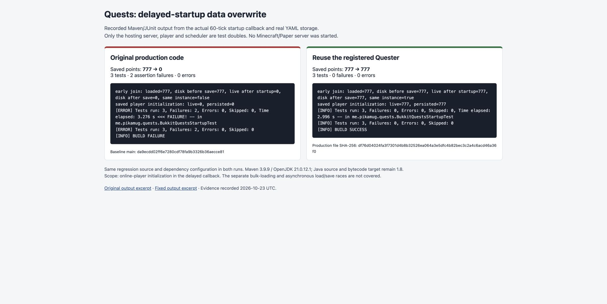

# Delayed-startup data regression

`BukkitQuestsStartupTest` covers the sixty-tick online-player callback in
`BukkitQuestsPlugin.delayLoadQuestInfo()`, the startup-overwrite case described in
[issue #2201](https://github.com/PikaMug/Quests/issues/2201).

The tests invoke the actual private startup method, capture its scheduled callbacks,
and execute the real sixty-tick callback. `BukkitQuester`, `QuesterStorage`, and
`BukkitQuesterYamlStorage` load and save real temporary YAML files. Only the hosting
server, player, scheduler, and plugin environment are test doubles.

The storage test subclass waits for each real asynchronous load to finish before
returning its original future. This selects a valid completion order and isolates
the replacement bug; it does not substitute loaded objects, values, or persistence.
The unrelated five-tick content loader is captured but not executed.

## Run

From the repository root, with Maven and a JDK compatible with the current server API dependencies:

```sh
mvn -pl bukkit -am -Dtest=BukkitQuestsStartupTest -Dsurefire.failIfNoSpecifiedTests=false -DfailIfNoTests=false test
mvn package
```

Validation used Maven 3.9.9 and OpenJDK 21.0.12.1 in an isolated Linux container.
The project's Java source and bytecode target remain 1.8. Mockito 4 retains Java 8
support, with test-scoped Byte Buddy versions that also support this build JDK.
Existing dependency-POM and shading warnings were present; the full package build succeeded.

## Recorded counterfactual

The same tests and test dependencies were first run with the original production
file from `da9ecdd02ff6e7280cdf78fa9b3326b36aecce81`, then with only the production fix applied.

| Scenario | Original | Fixed |
| --- | --- | --- |
| Player already loaded with 777 points | Replaced by a different object; the next save writes 0 | Same object; the next save retains 777 |
| Saved player not yet registered | Initialization leaves 0 in memory and on disk | Initialization retains 777 in memory and on disk |
| New player without a save | Initializes and saves 0 | Initializes and saves 0 |

Original: 3 tests, 2 assertion failures, 0 errors. Fixed: 3 tests, 0 failures, 0 errors.
The complete Maven reactor package build also passed all seven modules.



This screenshot displays recorded test output. It is not a running Paper server or
an in-game demonstration. These tests do not establish correctness for the separate
bulk-loading and asynchronous load/save races mentioned in the issue.
